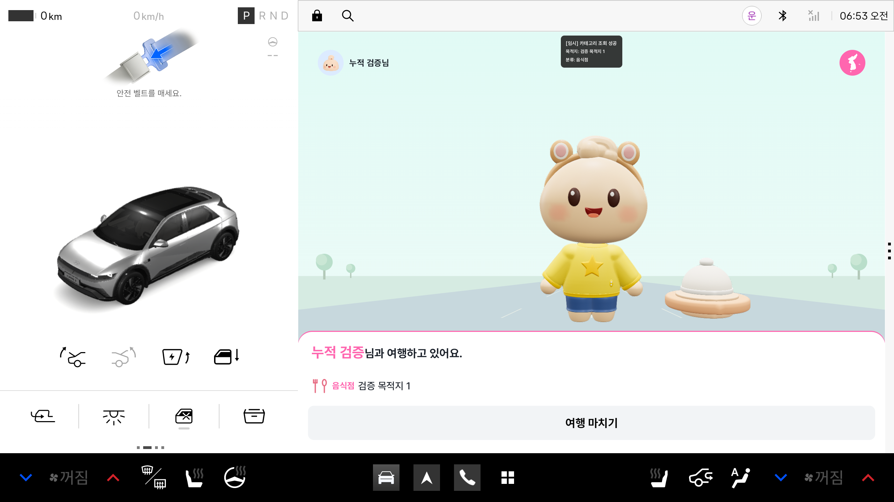
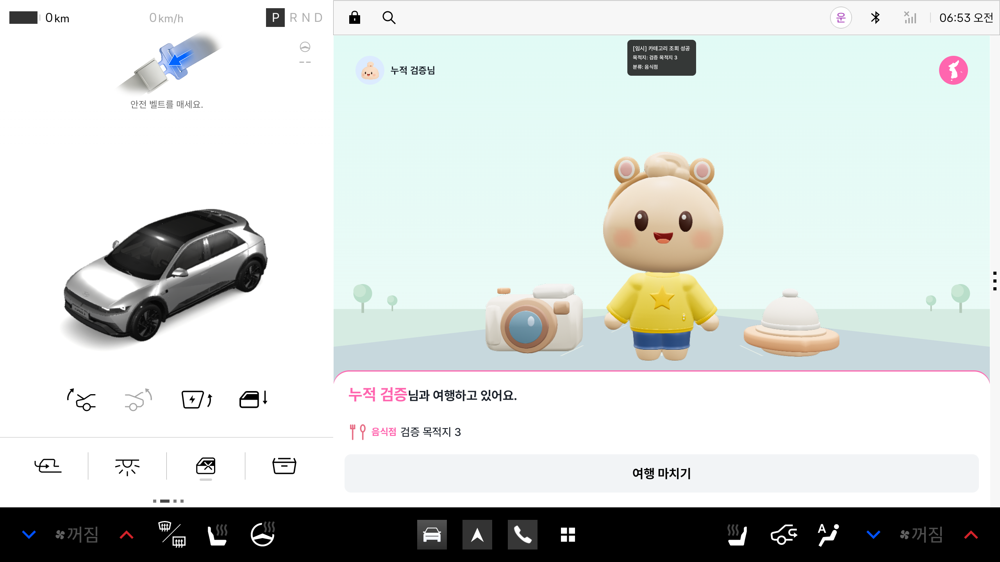
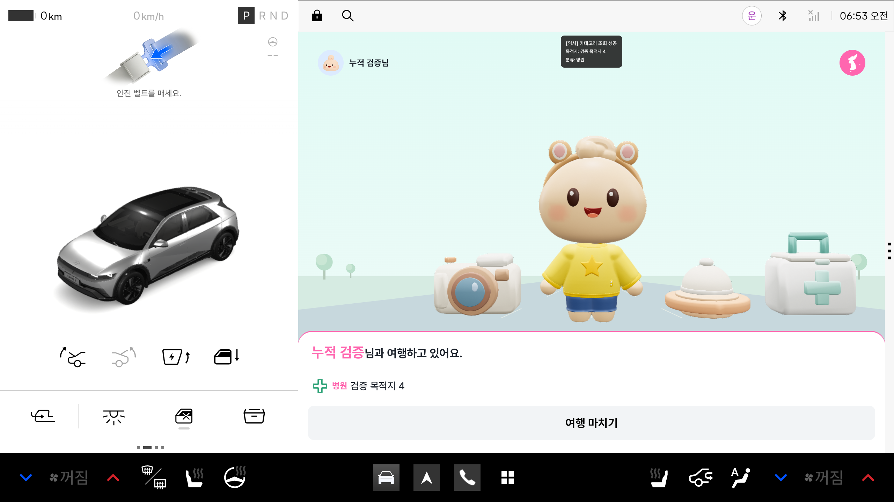
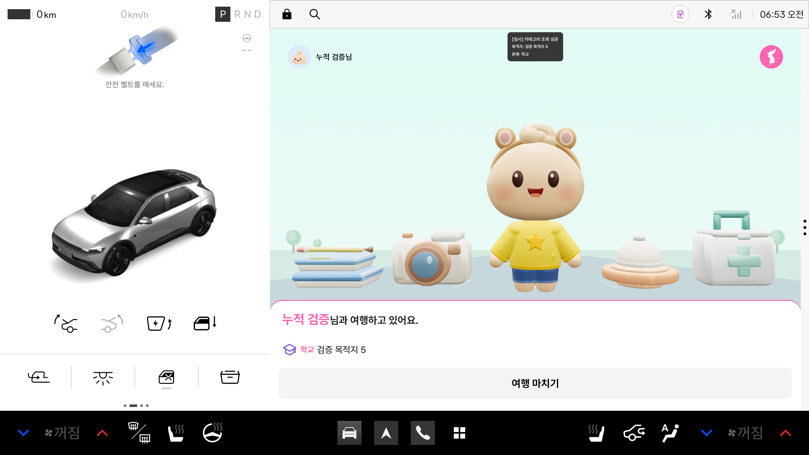
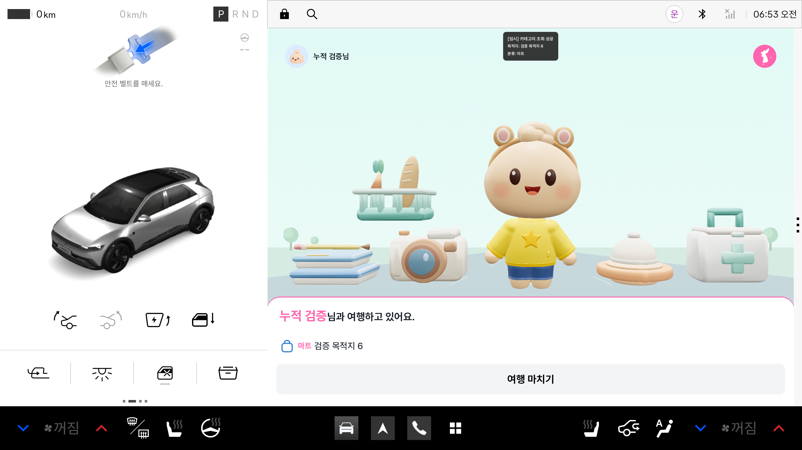

# #29 여행별 소품 누적·저장 검증

## 동작과 저장 범위

확정된 목적지 카테고리를 여행 세션에 연결해 최초 획득 순서대로 최대 5개 저장한다. 음식 → 관광 → 음식 → 병원 → 학교 → 마트 순서의 소품 개수는 1 → 2 → 2 → 3 → 4 → 5개다. 재방문과 목적지 변경, 도착 확인 후에도 이전 소품의 슬롯을 유지한다.

Room 스키마 4→5에서 `trip_session_props` 테이블과 세션 ID 고유 인덱스를 추가한다. 기존 프로필·기록·캐릭터 세션은 보존하고 소품은 빈 목록으로 시작한다. 복원된 현재 목적지가 확정 상태이면 동일한 획득 함수로 채운다.

획득 트랜잭션은 프로필·활성 세션 ID를 검증하고, 카테고리 중복과 최대 개수를 확인한 뒤 순서를 저장한다. 여행 종료 트랜잭션은 이전 소품을 정리하고 새 READY 세션으로 전환하므로, 종료된 세션의 늦은 요청은 새 여행에 지급되지 않는다. 완료 여행의 소품 목록을 별도 이력으로 보관하는 기능은 포함하지 않는다.

카테고리 조회 실패는 1초·2초 간격으로 최대 두 번 재시도한다. 조회 중·실패 결과에는 소품을 지급하지 않으며 무작위 카테고리를 만들지 않는다. 수동 선택한 카테고리는 반영하고 ‘기타’는 지급하지 않는다. 조회 중 도착 확인을 해도 확정 방문을 유지해 늦은 성공 응답을 처리한다. 수동 선택의 저장은 여행 ViewModel 범위에서 실행해 지도 등으로 화면을 전환해도 계속된다.

## 환경 및 실행 결과

기준 main: `f541a4d` (#31 화면 개선이 머지된 상태).

- Pleos Connect 2.1.0 / Android 14 에뮬레이터, 2560×1440.
- 테스트 앱은 임시 init script의 `.issue29` applicationIdSuffix로 다른 브랜치의 설치 앱과 분리했다. 제품 빌드 설정은 변경하지 않았다.
- 단위 테스트 75개, 계측 테스트 8개: 실패·오류·스킵 0개.
- `assembleDebug`, `ktlintCheck`, `lintDebug`: 통과.

| 검증 | 확인 결과 |
|---|---|
| 중복 카테고리·획득 순서 | 음식 재방문은 추가하지 않고 기존 슬롯 유지 |
| DB 재열기 | sessionId·lookId·소품 목록 복원 |
| 동시 획득 요청 100개 | 5개 고유 카테고리와 순서 0~4 유지 |
| 종료와 획득 경쟁 | 새 세션은 빈 목록, 이전 세션 요청 거부 |
| 잘못된 프로필·READY 세션 | 지급 거부 |
| 마이그레이션 4→5 | 기존 기록·캐릭터 유지, 확정 목적지 보충은 멱등 처리 |
| 프로필 삭제 | FK cascade로 소품 정리 |
| 확정 전 목적지·조회 중·조회 실패 | 지급하지 않음 |
| 조회 성공·재시도 성공·수동 선택 | 확정된 카테고리 지급, ‘기타’에는 지급하지 않음 |
| 도착 확인 후 늦은 조회 | 같은 여행에 반영 |
| 저장 대기 중 화면 종료 | 여행 범위의 저장 작업 완료 |
| 실제 홈 화면 | Repository 관찰 목록이 1~5개로 누적되어 렌더링 |

재실행 명령:

```sh
./gradlew :app:testDebugUnitTest ktlintCheck :app:assembleDebug :app:lintDebug
ANDROID_SERIAL=emulator-5554 ./gradlew :app:connectedDebugAndroidTest \
  -Pandroid.testInstrumentationRunnerArguments.class=com.triparchive.TripSessionPropStorageTest,com.triparchive.TripSessionStorageTest,com.triparchive.DestinationCategoryMigrationTest,com.triparchive.presentation.home.TripPropAccumulationTest
```

## 실제 누적 화면

`TripPropAccumulationTest`는 목적지 이벤트와 카테고리 결과를 주입하되 실제 ViewModel·Room Repository·DestinationHome·3D 모델을 실행한다. 소품 목록을 화면에 직접 주입한 테스트가 아니다. 음식 재방문 뒤에도 2개이며, 이후 병원·학교·마트가 획득 순서대로 추가된다.

| 1개: 음식 | 2개: 음식·관광 (음식 재방문 후에도 유지) |
|---|---|
|  |  |

| 3개: 병원 추가 | 4개: 학교 추가 |
|---|---|
|  |  |



## 검증 한계

- 카테고리 조회 재시도는 대체 분류기로 검증했다. 실제 카카오 API 장애·복구나 실차 내비게이션 목적지 조작은 수행하지 않았다.
- 재실행 복원은 DB를 닫고 다시 여는 저장소 테스트로 검증했다. 앱 프로세스 강제 종료·복원을 직접 자동화한 것은 아니다.
- 캡처는 아이 기본 의상, 정차 상태다. 소품 크기·반응형 배치는 #31 구현을 사용한다.
