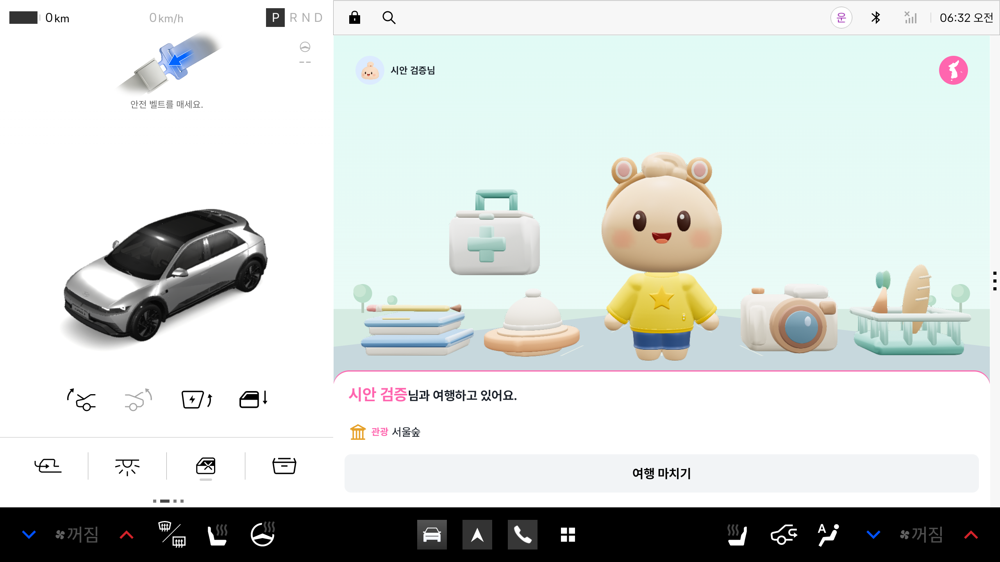
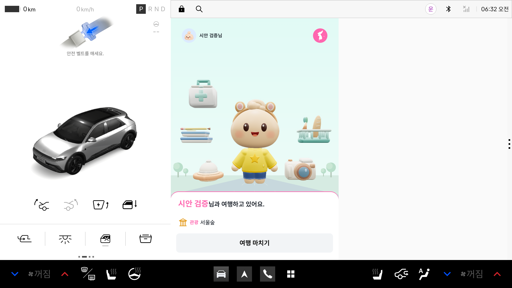
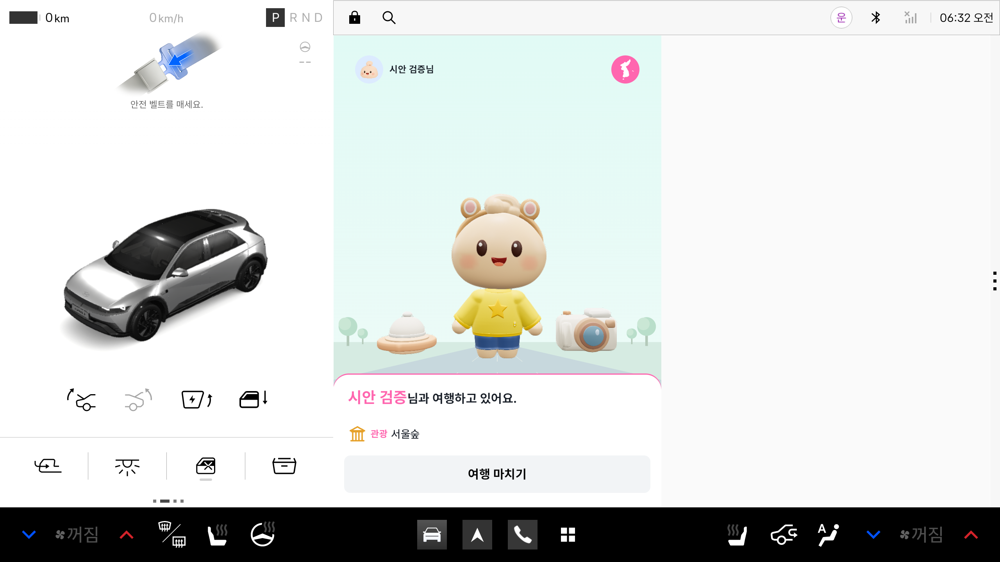
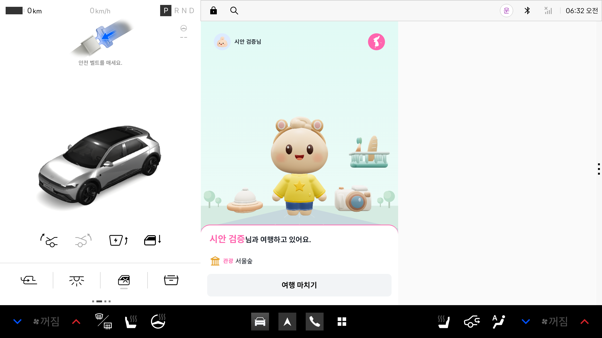
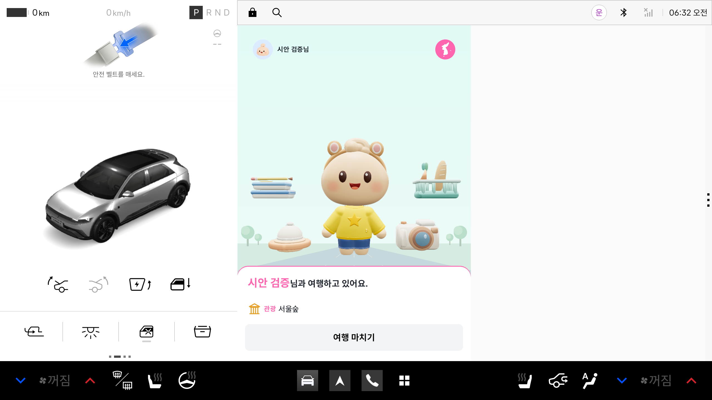

# #31 홈 화면 검증

건물을 제거하고 옅은 도로·나무를 남겨 캐릭터와 소품이 중심이 되도록 변경했다. 넓은 화면은 획득 순서대로 오른쪽 발 옆, 왼쪽 발 옆, 오른쪽 바깥, 왼쪽 바깥, 왼쪽 뒤편 슬롯을 채운다. 화면의 가용 너비가 높이보다 작으면 캐릭터 뷰포트를 25% 확대하고 아래로 이동하며, 3·4번째 소품을 양쪽 위로 올리고 5번째를 얼굴과 떨어진 왼쪽 뒤편에 배치한다. 좁은 화면의 소품 크기는 유지하고 도로 지평선은 화면 높이의 58%에서 65%로 내렸다.

Filament 모델 로딩은 메인 스레드에서 처리하고, 뼈대 애니메이션은 실제 SceneView 렌더 프레임에서만 갱신한다. 권한 창 등으로 렌더링이 멈췄을 때 별도 Compose 루프가 GPU 명령을 계속 생성하던 충돌을 수정했다. 화면 모드 전환 시에는 모델을 유지하면서 렌더 화면을 재생성해 이전 텍스처가 늘어나 보이는 현상도 수정했다.

## 검증 환경과 범위

- Pleos Connect 2.1.0 에뮬레이터 / Android 14 / 2560×1440 디스플레이.
- `HomeLayoutTest`에서 실제 `HomeScreen`, 3D 모델, `HomeDestinationSheet`를 ActivityScenario와 실제 프레임으로 실행했다.
- 아이 프로필, 관광 → 음식 → 마트 → 학교 → 병원 순서의 검증용 카테고리 데이터 사용.
- 넓은 화면 → 840dp 너비에서 소품 2·3·4·5개 → 넓은 화면 복귀를 확인했다. 좁은 화면은 테스트 컨테이너의 폭을 제한한 것으로, 내비게이션 앱과의 실제 분할 실행을 자동화한 것은 아니다.
- Activity를 STARTED 상태로 12초 유지한 후 RESUMED로 복귀해 네이티브 충돌 없이 테스트가 끝나는 것을 확인했다.
- 테스트 앱에는 임시 Gradle init script로 `.issue31` applicationIdSuffix를 붙여 다른 브랜치의 설치 앱과 분리했다. 저장소의 제품 빌드 설정은 변경하지 않았다.

## 실행 결과

| 검증 | 결과 |
|---|---|
| `:app:assembleDebug` | 통과 |
| `:app:testDebugUnitTest` | 68개 통과, 실패·오류 0개 |
| `ktlintCheck` | 통과 |
| `:app:lintDebug` | 통과 |
| `HomeLayoutTest` 계측 테스트 | 1개 통과 (폭 전환, 소품 2~5개, 12초 일시정지·복귀) |

재실행 명령(연결된 Pleos 에뮬레이터 필요):

```sh
./gradlew :app:assembleDebug :app:testDebugUnitTest ktlintCheck :app:lintDebug
ANDROID_SERIAL=emulator-5554 ./gradlew :app:connectedDebugAndroidTest \
  -Pandroid.testInstrumentationRunnerArguments.class=com.triparchive.presentation.home.HomeLayoutTest
```

## 실제 캡처

생성 이미지가 아닌 에뮬레이터 스크린샷이다. 현재 앱의 3D 모델을 사용하므로 승인 시안과 의상·소품 재질은 다르다.

| 넓은 화면 — 소품 5개 | 좁은 화면 — 소품 5개 |
|---|---|
|  |  |

| 좁은 화면 — 2개 | 좁은 화면 — 3개 | 좁은 화면 — 4개 |
|---|---|---|
|  |  |  |

## 남은 검증 및 연계 범위

- 소품 누적·저장 로직은 #29 범위다. 이 검증은 카테고리 목록을 주입해 배치를 확인한다.
- 이번 캡처 검증은 아이 기본 의상 기준이다. 모든 관계·의상 조합, 실차 및 실제 내비게이션 분할 화면은 별도 확인 대상이다.
- 속도 연동 차선 로직은 유지했다. 이번 계측 테스트는 정차 상태이며 실차 주행 중의 시각 검증을 대신하지 않는다.
